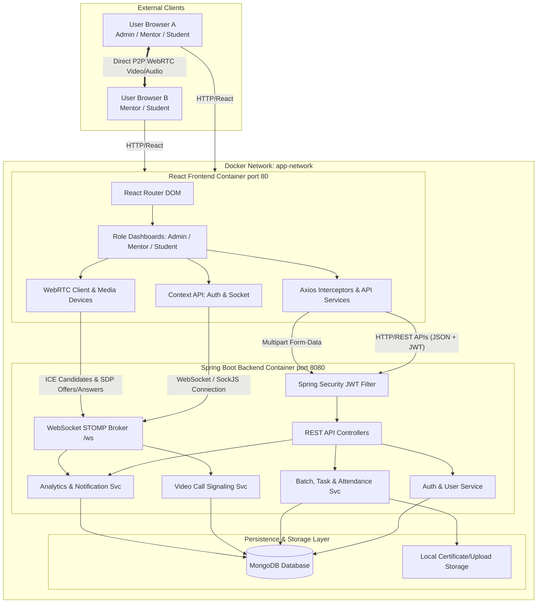
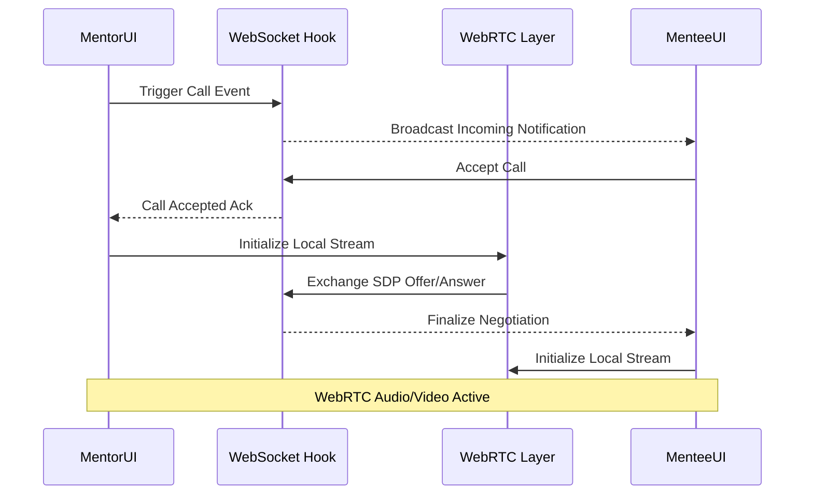

# MenteeConnect — Frontend

<div align="center">
  
  
  
  
  
  
  <a href="https://menteeconnect.vercel.app/" target="_blank">
    
  </a>
</div>

<div align="center">
  <h3>React Frontend for Role-Based Mentor-Student Management</h3>
  <p><em>A feature-rich academic mentorship platform with real-time video calling, goal tracking, and role-based dashboards for Admins, Mentors, and Students.</em></p>
  <br/>
  <strong><a href="https://menteeconnect.vercel.app/">menteeconnect.vercel.app</a></strong>
</div>

---

## Architectural Flow

MenteeConnect utilizes a modern React-based architecture with robust real-time communication capabilities and centralized state management.



## Key Features

- **Multi-Role Dashboards:** Distinct and personalized experiences tailored for Admins, Mentors, and Students.
- **Live Video Calls:** WebRTC-powered, low-latency 1-on-1 video sessions integrated directly into the platform.
- **Real-Time Notifications:** Instant WebSocket alerts for incoming calls, assignments, and platform announcements.
- **Comprehensive Meeting History:** Dashboards for Mentors to review past sessions and for Admins to audit all platform-wide meetings.
- **Goal & Progress Tracking:** Workflow for assigning, monitoring, and validating student goals and certificates.
- **Batch & Attendance Management:** Structured interfaces for tracking student cohort progress and daily attendance.
- **Secure Token Management:** Seamless JWT authentication flow with automatic background token refresh mechanisms.
- **Modern Responsive UI:** A premium, fully responsive interface styled meticulously with Tailwind CSS.

---

## Role Specifications

### Admin Capabilities
- Centralized user administration (Mentors and Students).
- Academic batch creation and mentor allocations.
- Platform-wide broadcast notifications.
- Comprehensive oversight of all video call histories and engagement metrics.

### Mentor Capabilities
- Dashboard oversight of allocated mentees.
- One-click initiation of video sessions directly with students.
- Personal meeting history tracking and review.
- Management of mentee progress, profile validation, and attendance logs.
- Assignment and evaluation of academic tasks.

### Student Capabilities
- View mentor details, track personal performance metrics, and manage profile information.
- Seamless reception and handling of incoming video call requests.
- Track assigned goals, upload certificates, and monitor skill progression.
- Receive real-time announcements from mentors and administrators.

---

## Video Integration Workflow

The application leverages WebRTC for browser-based, plugin-free video communication.



---

## Technology Stack

| Category       | Technology                           |
|----------------|---------------------------------------|
| Core Framework | React 18+                             |
| Styling        | Tailwind CSS 3+                       |
| HTTP Client    | Axios                                 |
| Routing        | React Router v6                       |
| Real-Time      | WebSocket (STOMP via SockJS)          |
| WebRTC         | Native Browser API                    |
| State & Auth   | Context API, JWT Interceptors         |

---

## Local Development Setup

### Prerequisites
- Node.js 16+
- npm or yarn package manager
- Backend service operating locally on port 8080

### Initialization Commands

```bash
# Clone and navigate to the frontend directory
cd mentee_connect_frontend

# Install necessary dependencies
npm install

# Launch the development server
npm start
```

---

## Project Structure

```text
frontend/
└── src/
    ├── components/        # Reusable UI elements (Buttons, Modals, VideoCall overlays)
    ├── pages/             # Route-level views (AdminDashboard, MentorDashboard)
    ├── context/           # Global application state managers (AuthContext)
    ├── hooks/             # Custom abstractions (useWebRTC, useWebSocket)
    ├── services/          # REST communication and interceptors (api.js)
    └── utils/             # Formatters, constants, and helper logic
```

---

## Developer

**Mahesh Shinde**

- **Email:** [maheshshinde9100@gmail.com](mailto:maheshshinde9100@gmail.com)
- **Portfolio:** [maheshshinde-dev.vercel.app](https://maheshshinde-dev.vercel.app)
- **LinkedIn:** [linkedin.com/in/maheshshinde9100](https://www.linkedin.com/in/maheshshinde9100)
- **GitHub:** [github.com/maheshshinde9100](https://github.com/maheshshinde9100)

*MenteeConnect is part of an academic mentorship platform. All rights reserved.*
